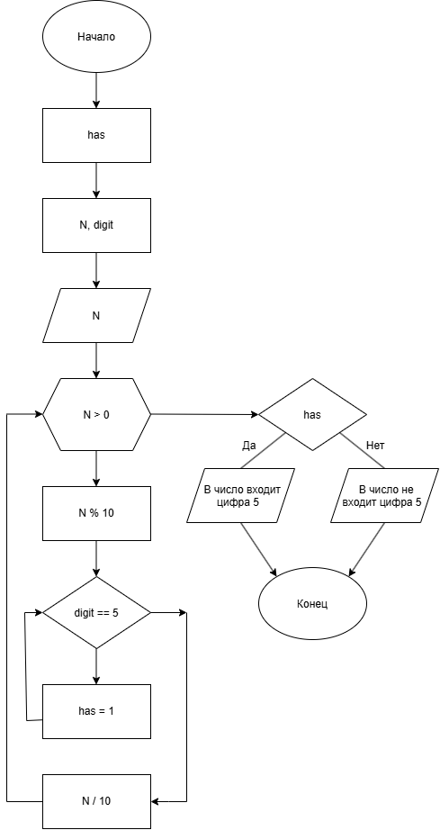

# Домашние задание к работе номер 6
## Условие Задачи
Дано число N (N<1000). Написать программу, которая проверяет входит ли в него цифра 5.
## 1. Алгоритм и блок-схема
### Алгоритм:
1. Начало
2. Объявить переменную вне функции:
- **has** - счётчик числа 5.
3. Объявить переменную в функции:
- **N** - вводимое значение пользователем числа;
- **digit** - пустая переменная для получения в неё дроблённых частей **N**.
4. Создать цикл while.
5. В теле цикла while написать:
- **digit = N % 10** - независимо получение переменной **digit** части значения **N**;
- **if (digit == 5)** - условие, если digit равен 5, значит осуществляется переход к следующей цифре значения **N** (**N = N / 10**)
6. Условие с использованием **has**:
- **if (has)** - если имеется **digit**, то происходит один вывод, если нет, то трудой.
7. Конец.
### Блок-схема:

## 2. Реализация программы
```c
#define _CRT_SECURE_NO_WARNINGS
#define _USE_MATH_DEFINES
#include <stdio.h>
#include <locale.h>
#include <math.h>

int has = 0;

int main()
{
	setlocale(LC_ALL, "RUS");

	int N;

	int digit;

	puts("Введите значение числа N (N<1000):");

	scanf("%d", &N);

	while (N > 0)
	{
		digit = N % 10;

		if (digit == 5)
		{
			has = 1;

			break;
		}

		N = N / 10;
	}

	if (has)
	{
		puts("В число входит цифра 5");
	}
	else
	{
		puts("В число не входит цифра 5");
	}
	
	return 0;
}
```
## 3. Результаты работы программы
Случай 1:
Введите значение числа N (N<1000):
500
В число входит цифра 5

Случай 2:
Введите значение числа N (N<1000):
462
В число не входит цифра 5
## 4. Информация о разработчике
Коваленко Вадим Валерьевич, бТИИ-261
